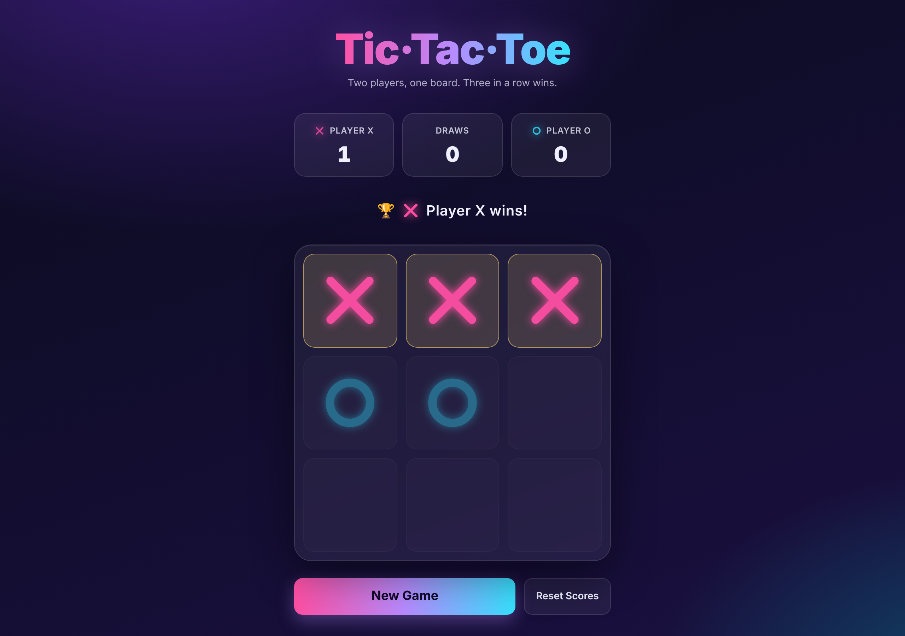
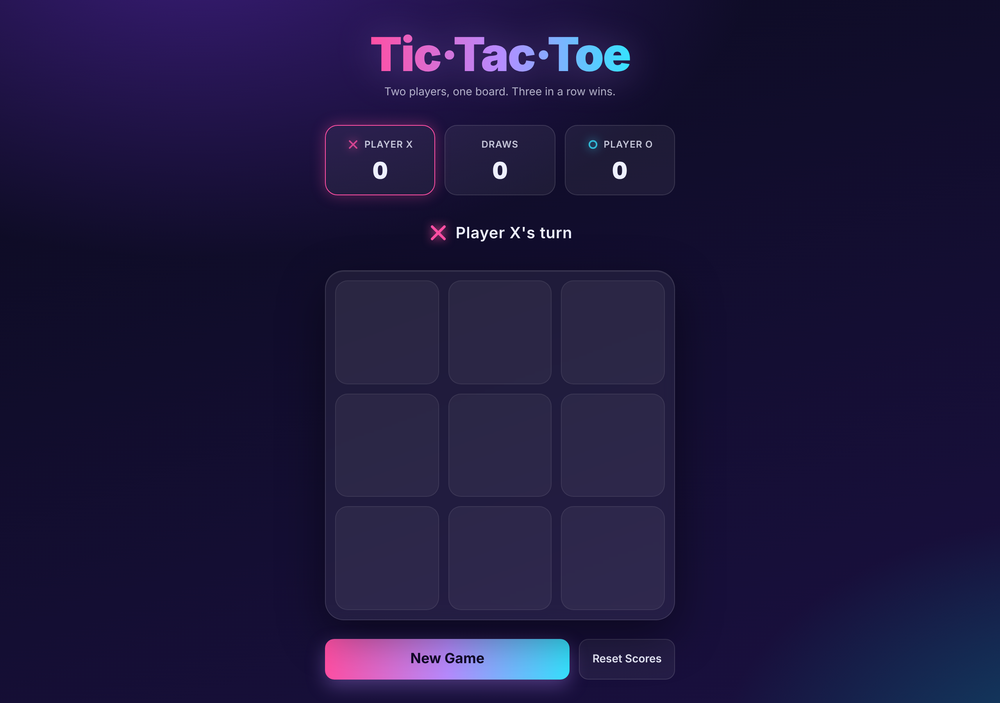
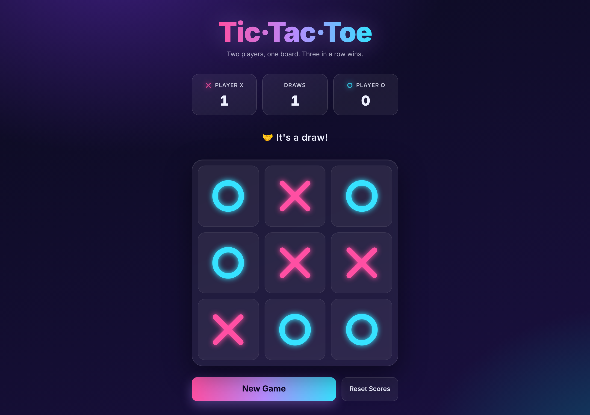
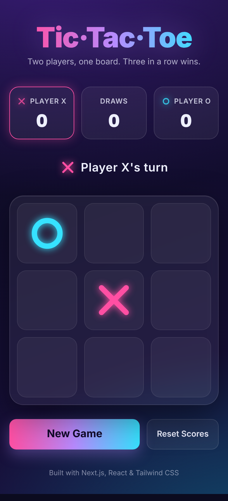

# Tic-Tac-Toe

A two-player Tic-Tac-Toe game built with **React 19**, **Next.js 15** (App Router) and **Tailwind CSS 4**.



## Features

- Two players take turns placing X and O on a 3×3 board
- Shows whose turn it is, who won, or that it's a draw
- **New Game** button starts a fresh round (the loser goes first next round)
- Scoreboard counting X wins, O wins and draws (saved in your browser), with **Reset Scores**
- Winning line highlight, animated neon marks, hover previews
- Responsive (works on phones), keyboard accessible, respects reduced-motion

## Run locally

```bash
npm install
npm run dev
```

Open http://localhost:3000.

## Deploy

```bash
npx vercel --prod
```

## Project structure

- `src/lib/game.ts` – pure game logic (win/draw detection, whose turn)
- `src/components/TicTacToe.tsx` – board, status, scoreboard and controls
- `src/components/Mark.tsx` – animated SVG X / O marks
- `screenshots/` – screenshots of the game

## Screenshots

| Start | Draw | Mobile |
| --- | --- | --- |
|  |  |  |
